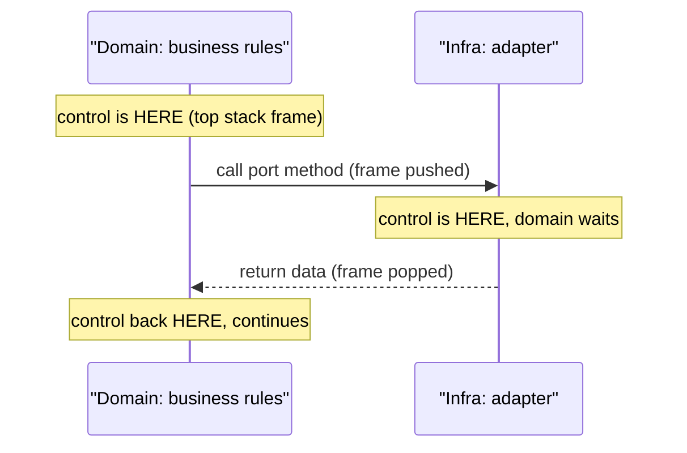
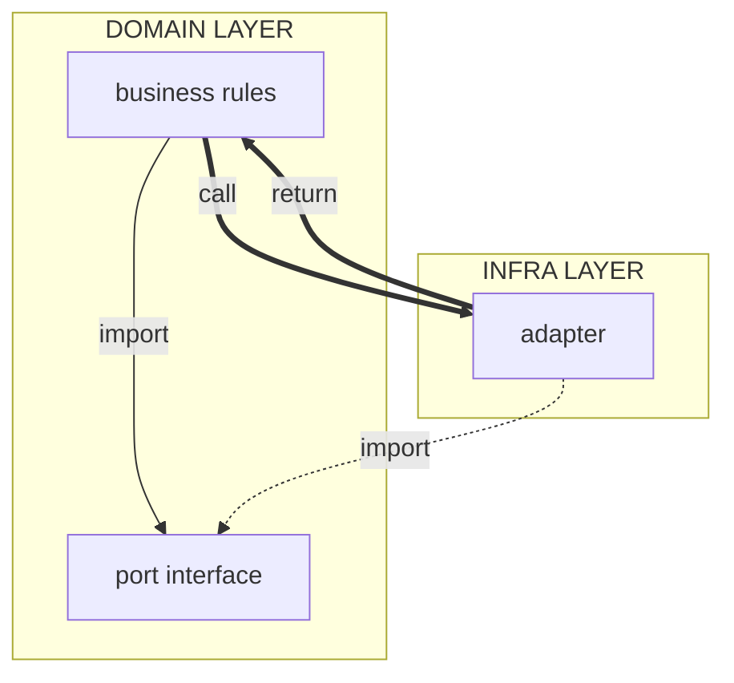

# Flow of Control vs Source-Code Dependency (DIP)

The "two arrows" of the Dependency Inversion Principle.

**Uncle Bob's wording (the anchor):** *the source-code dependency points in the
direction opposite to the flow of control.*

## What "control" is

Control = which code the CPU executes **now**: the program counter plus the
active stack frame. "Flow of control" = the path the thread takes through the
code over time. Each call pushes a frame and moves control into the callee;
each return pops the frame and moves control back.

ELI5: control is a baton. Only one runner holds it. The domain hands the baton
to the adapter when it calls the port method, waits, and gets the baton back
with the data when the adapter returns.

Rules:

- Control **always** flows domain → infra detail. The policy must cause the IO
  to happen. DIP never changes this arrow.
- DIP inverts only the **compile-time import**: the adapter (infra) points UP
  to the port interface (domain). The domain imports nothing from infra.

## Runtime control (call stack view)



ASCII rendering (for terminal viewing):

```text
 +----------------------------+           +--------------------+
 |  Domain: business rules    |           |  Infra: adapter    |
 +----------------------------+           +--------------------+
                :                                    :
+-----------------------------------+                :
| control is HERE (top stack frame) |                :
+-----------------------------------+                :
                : call port method (frame pushed)    :
                ------------------------------------->
                :                                    :
                :                    +-------------------------------+
                :                    | control is HERE, domain waits |
                :                    +-------------------------------+
                : return data (frame popped)         :
                <.....................................
                :                                    :
+------------------------------+                     :
| control back HERE, continues |                     :
+------------------------------+                     :
```

## The two layers, both arrow types



ASCII rendering (for terminal viewing):

```text
 +----------------------+
 | DOMAIN LAYER         |
 |                      |
 | +------------------+ |
 | |                  | |         return
 | |  business rules  |<=============================+
 | |                  | |                            H
 | +------------------+ |                            H
 |           H          |                            H
 |           H          |                            H
 |           +===========================+           H
 |           |          |                H           H
 |           |          |                Hcall       H
 |     import|          |    +-----------H----------+H
 |           |          |    | INFRA LAYER          |H
 |           v          |    |           v          |H
 | +------------------+ |    | +------------------+ |H
 | |                  |import| |                  | |H
 | |  port interface  |<.......|     adapter      |==+
 | |                  | |    | |                  | |
 | +------------------+ |    | +------------------+ |
 +----------------------+    +----------------------+
```

How to read the layer boundary: the double lines (`=`, runtime control) cross
**down** into infra and back. The dotted line (compile-time import) crosses
**up** into the domain. Two different kinds of arrow, pointing opposite ways
across the same boundary — that opposition is the inversion.

## Key details

1. The port interface lives **inside the domain layer** — the domain owns the
   port file, the adapter comes to it.
2. Business rules import only the port, never the adapter. The domain knows
   nothing about the adapter.
3. At runtime the call goes through a reference **typed as the port** but
   lands in the adapter's code — that is where control transfers.
4. The **composition root** is the only place that knows both sides — it
   constructs the adapter and injects it into the business rules.

## Naming trap

"Inversion of Control" (IoC, the Hollywood principle — a framework calls
*your* code) is a different idea from the **Dependency Inversion Principle**
(DIP), which is what ports/adapters use. In DIP, control is never inverted —
the import arrow is.
