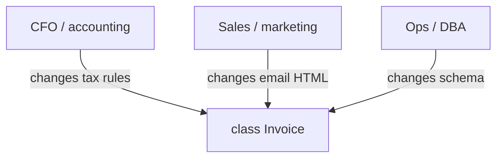
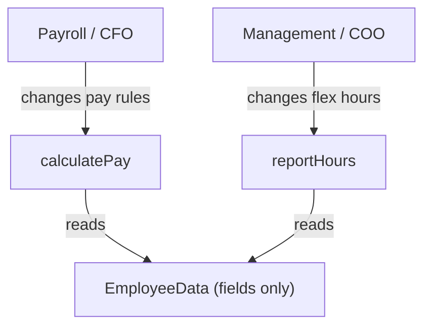

# SRP — actors, not verbs

> Session 2, 2026-08-29. Stage 2 (SOLID at class level), letter S.
> Source: `design-principles` skill archive, `references/solid.md` (verified in
> session). Invariant/policy split is DDD territory, not in that archive —
> answered from principle and flagged as such.

## Canonical statement

> "A class should have one, and only one, **reason to change**."
> — Robert C. Martin, *Principles of OOD* (2000)

## The unit SRP counts

| | counts what | unit |
|---|---|---|
| folklore ("does one thing") | what the code *does* | verbs, methods, mutations |
| **SRP** | who *asks* for the change | **people** |

**A "reason to change" is an actor** — a person or department that requests
changes. Accounting changes tax rules. Ops changes the schema. Sales changes the
email template. Three actors, regardless of how many things the code mutates.

**The test:** *how many parties can sign off on a change to this file?*

**Size is not the test.** 900 lines + one actor passes. 40 lines + two actors
fails.

## The violation



```ts
class Invoice {
  total(): number { /* tax rules      -> CFO   */ }
  save(db: Database): Promise<void> { /* schema -> Ops */ }
  toCustomerEmailHtml(): string { /* template  -> Sales */ }
}
```

Ops changes the schema; the CFO's tax code is re-tested and re-deployed.

## The non-violation (does three things, still correct)

```ts
class ShippingLabel {
  computeWeightBand(): Band   // carrier's weight tiers
  formatAddress(): string     // carrier's address format
  renderBarcode(): Buffer     // carrier's barcode spec
}
```

One actor (the carrier spec) drives all three. They co-change. Leave it alone.

## The fix: shared data, split behaviour

Two actors needing the same fields is the common case. Don't duplicate the data;
don't merge the behaviour. The data goes **inert** in the middle.



```ts
type EmployeeData = {
  readonly id: EmployeeId;
  readonly hourlyRate: Money;
  readonly hoursWorked: Hours;
};

// changes with payroll
function calculatePay(e: EmployeeData): Money { ... }

// changes with management
function reportHours(e: EmployeeData): Hours { ... }
```

Flex-hours ships without re-testing payroll.

## Steering coding agents

Told to "apply SRP", agents split by **verb** — one class per method plus a
facade:

```
- class ShippingLabel { computeWeightBand(); formatAddress(); renderBarcode(); }
+ class WeightBandCalculator { ... }
+ class AddressFormatter    { ... }
+ class BarcodeRenderer     { ... }
+ class ShippingLabelFacade { ... }
```

Review comment: **"You counted verbs; SRP counts actors — name me the second
stakeholder or revert this."**

Splitting by verb with no second stakeholder is speculative structure, not SRP.

## Invariants tight, policy loose

Where does "keep the domain tight" (DDD instinct) sit against SRP? They don't
conflict — they govern two different kinds of rule.

**Discriminator: if this rule changed, who would ask for it?**

| answer | kind | where it lives |
|---|---|---|
| nobody — it would just be a bug | **invariant** (`hoursWorked >= 0`, `Money` has 2 decimals) | on the type |
| a named department | **policy** (overtime above 40h, tax = 21%) | outside, in that actor's module |

Nobody signs off on an invariant, so there is no second actor and no SRP
violation. Policy always names a stakeholder.

**Enforce invariants at construction, not in setters.** A validating setter still
permits a moment where an invalid object exists.

```ts
// invariant enforced once; no invalid EmployeeData can exist
function makeEmployeeData(raw: RawInput): Result<EmployeeData, ValidationError> { ... }
```

## Carried from the opening drill

- **Usage is not ownership.** Both domain and infra *use* a port; only the side
  that *needs* it gets to define it. It never moves to `shared/` — the domain
  would stop owning the contract it depends on, and the arrow from infra would
  stop pointing into the domain.
- **State the domain need as a sentence before naming a port.** "Must know
  whether this customer can actually be charged" -> `Payment.isUsable(customerId)`.
  Naming before articulating produces mechanism-shaped names (`CreditCardClient`)
  that die the moment the mechanism changes.
