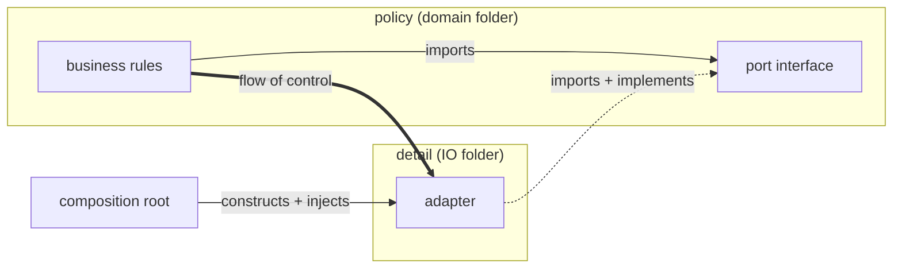

# Design Principles — session journal

<!-- newest session at top -->

## Session 2 — 2026-08-29 — Stage 2 opens: SRP (actors, not verbs)

**Deck state at open:** 12 cards, **0 reviewed** — no retrieval has happened
since session 1. Nothing due, no leeches (nothing has been seen). Flagged.

**EXPERIMENT RESULT — frame-shift drill: SUCCESS.** Opened with the
interface-placement rule in 4 rapid costumes (folder choice, review sentence,
naming, diff prediction) before any new content. **Placement slip did not fire
once** — clean in costumes 1, 2 and 4, versus 3 slips in one session previously.
Verdict: forced transfer practice at session start beats re-teaching. **Adopt as
a standing opener for any rule with a recorded slip.**

Two other slips did fire in the drill, both resolved by quote-back:
- **Vocabulary:** called the domain-side file "the adapter" one line after
  correctly separating `InvoiceStore` from `PgInvoiceStore`. Quoted both
  sentences back; fixed instantly (confirmed technique, 3rd success).
- **Naming (2nd occurrence):** `CreditCardClient.verifyValid()` — mechanism-
  shaped. Root cause isolated and named to him: **he names before he articulates
  the need.** Hard scaffold (complete "the domain must know whether ___", with
  vendor/mechanism nouns banned) recovered it in one attempt ->
  `Payment.isUsable(customerId)`. Slip mechanism is now explicit, not just the
  slip.

**SOLID probe (was TBD since session 1): all five self-rated fuzzy / name-only.**
Scope was explicitly capped to S today; L, I, D get their own sessions, D is
half-built from stage 1.

**Chunks named this session:**
1. **Actors, not verbs** — a "reason to change" is a person/department, not a
   verb. Test: how many parties can sign off on a change to this file.
2. **Size is not the test** — 900 lines/one actor passes; 40 lines/two actors fails.
3. **Shared data, split behaviour** — two actors needing the same fields get an
   inert data object plus one module per actor.
4. **Invariants tight, policy loose** — discriminator: "if this rule changed,
   who would ask for it?" Nobody -> invariant, on the type, enforced at
   construction. A department -> policy, outside.

**Learner-generated, unprompted:** he asked where his DDD "keep the domain tight"
instinct fits against SRP. That question produced chunk 4 — the best material of
the session came from him, not the plan. His instinct was correct and only needed
the invariant/policy line drawn through it. (Told him plainly this is not in the
design-principles archive and was answered from principle — process-audit rule.)

**Exercise results:**
- Actor-counting contrast (ShippingLabel 3 verbs/1 actor vs Employee 2 verbs/2
  actors): **correct on all three parts, first attempt**, including the hard half
  (why the 3-verb class correctly stays whole). Reproduced Uncle Bob's own
  Employee example nearly verbatim.
- Agent-review costume (verb-split diff + facade): **right verdict, wrong test** —
  rejected the split using a *size* argument, not the actor argument, two messages
  after stating the actor test. Signature firing on schedule. Quote-back fixed it.
- Fix costume: produced the shared data object unaided, then loaded it with
  formatting + rules — i.e. rebuilt a two-actor class one layer down. Corrected.

**Quiz (5 Qs, mixed): 5/5.** Q4 used "invariants tight, policy loose" unprompted
five minutes after learning it, and drew the line correctly between what a
discount code *is* (8 chars -> on the type) and *when it applies* (policy ->
outside). Transfer, not recall.

**Effort:** 70 mid-session — productive-struggle band, up from 50 in session 1.
The harder opening did what it was meant to.

**Cards:** 13 added, tags `stage::2`; 9 of 13 higher-order. Deck now 25.

**Artifacts:** `docs/srp-actors-not-verbs.md` (both mermaid diagrams, code, the
agent-review line, the invariant/policy table). Terms settled in `terms.md`:
actor, reason to change, invariant, policy, inert data object.

**Next experiment (ONE):** open session 3 with **Anki review as the warm-up** —
the 25 cards have never been seen, and the whole spaced-retrieval half of the
method is currently doing nothing. Hypothesis: cold card review will expose which
stage-1 chunks have actually decayed, and is cheaper than re-quizzing them by
hand. Measure: which cards fail vs which chunks the journal says were solid.

**Session 3 plan:** Anki warm-up -> frame-shift drill on the *naming* rule (the
one slip still live, now 2 occurrences) -> OCP. Open OCP application-first with a
"add a third payment type" scenario before naming the principle.

**Competence:** Stage 1 core inversion holds under costume change (placement slip
now 0/4 after 3/3 previously) — **gate for stage 1 met.** Stage 2 letter S at
conscious competence, transferred once into an unprompted new frame. S not yet
gated: the agent-review costume still pulled a substitute criterion.

## Interlude — 2026-08-22 — "what is control?" clarification (Stage 1 chunk 1)

Learner-initiated. He arrived with 4 statements; #2–#4 correct, #1 claimed the
*runtime flow of control* is inverted — contradicting his own #4. Quoted both
sentences back (confirmed technique): he reconciled unaided and cleanly:
"control always flows from domain to infra details; DIP just inverts the
import." Adopted Uncle Bob's wording as his anchor: *the source-code dependency
points in the direction opposite to the flow of control.*

**Taught into the gap:** control = program counter + active stack frame (his
own stack intuition, confirmed); baton metaphor (supplied, landed). Named the
IoC-vs-DIP naming trap as the likely source of statement #1.

**Transfer check (review costume — his slip zone):** PR with domain class
importing `Stripe` directly, author defends via the control arrow. He caught it
first try: "pointing to the infra implementation instead of the port." No slip.

**Artifacts:** rewrote `flow-of-control.md` — control definition, sequence
diagram (stack view), two-layer diagram with both arrow types, naming trap.
Terms settled in `terms.md`: control, flow of control, DIP vs IoC.
3 cards added to `DesignPrinciples` (stage::1): control = PC + active stack
frame; Uncle Bob DIP sentence; DIP-vs-IoC contrast (which arrow inverts).

**Two-arrows chunk status:** the muddled articulation from session 1's quiz is
resolved — he now states the asymmetry precisely and transferred it into a
review frame. Interface-placement slip untested this interlude (still gating).

## Session 1 — 2026-08-14 — Stage 1: dependencies are the enemy (DIP threshold)

**Type A (new topic).** Intake: goal = all three retrieval needs (own design,
review, steering agents); scope = Clean Architecture arc; pace = intensive;
prior = "apply some SOLID, fuzzy on others" (which letters are weak: still TBD —
probe in session 2).

**Opening:** application-first (confirmed experiment) — InvoiceCalculator
importing PgClient, "Postgres → Dynamo, what breaks?". Worked again: he found
the coupling and proposed data-passing unprompted, and derived interface
ownership (option B) correctly on first ask.

**Chunks named this session:**

1. **Two arrows** — flow of control (runtime, domain→detail) vs source-code
   dependency (imports). The DIP "inversion" = imports pointing AGAINST control.
2. **Interface ownership** — the caller/policy owns the port file; the
   implementer imports it. ⚑ his weak spot, see below.
3. **Data vs port** — deciding property is WHEN the domain needs it:
   knowable before the flow starts → plain data; effect/live read mid-flow →
   port. His native instinct is data-passing; ports had to be taught.
4. **Port / adapter / composition root** vocabulary; ports named after the
   domain need, never the vendor (didn't know what Sendgrid was — check vendor
   familiarity before using vendors in scenarios).

**Quiz (5 Qs, mixed):** 2 clean (why injection alone fails; data-vs-port split),
3 partial (two-arrows articulation muddled; port named after the data not the
capability; **moved the interface out of the domain folder — 3rd occurrence in
one session**).

**Known failure signature CONFIRMED on new topic:** states the rule perfectly
in one frame, slips when the frame changes. Specific recurring slip:
**interface placement drifts out of the domain folder** whenever the question is
re-costumed (review feedback, naming exercise). Card #2 anchors it.

**Cards:** 9 added to new deck `DesignPrinciples`, tags `stage::1`,
3 higher-order. Includes rote-residue card (parameter vs argument,
Placeholder/Actual mnemonic, at creation per profile).

**Effort:** 50 mid-session (slightly under productive-struggle band — push
harder next time).

**Next experiment (ONE):** open session 2 with a *frame-shift drill* — the same
interface-placement rule asked in 4 rapid costumes (folder choice, review
sentence, naming, diff prediction) BEFORE new content. Hypothesis: forced
transfer practice at session start fixes the placement slip better than
re-teaching. Measure: slips in the drill vs slips later in the session.

**Session 2 plan:** frame-shift drill → probe which SOLID letters are fuzzy →
begin Stage 2 (SRP first, as "one reason to change" = one axis of change).

**Competence:** Stage 1 ≈ conscious competence on the core inversion; not yet
gated — placement slip must stop before advancing past Stage 2 material that
builds on it.
