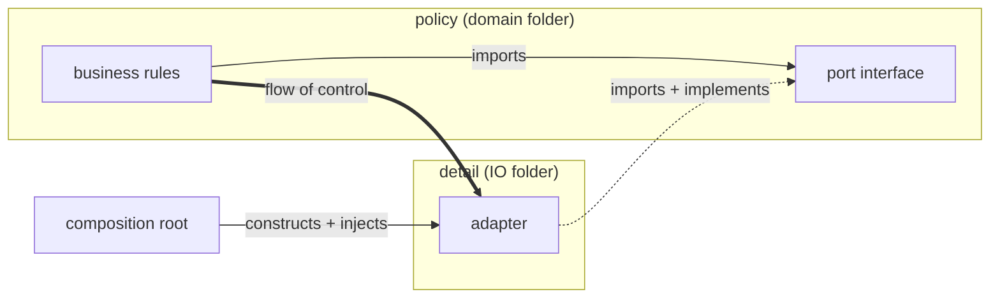

# Design Principles — session journal

<!-- newest session at top -->

## Session 1 — 2026-08-14 — Stage 1: dependencies are the enemy (DIP threshold)

**Type A (new topic).** Intake: goal = all three retrieval needs (own design,
review, steering agents); scope = Clean Architecture arc; pace = intensive;
prior = "apply some SOLID, fuzzy on others" (which letters are weak: still TBD —
probe in session 2).

**Opening:** application-first (confirmed experiment) — InvoiceCalculator
importing PgClient, "Postgres → Dynamo, what breaks?". Worked again: he found
the coupling and proposed data-passing unprompted, and derived interface
ownership (option B) correctly on first ask.

**Chunks named this session:**

1. **Two arrows** — flow of control (runtime, domain→detail) vs source-code
   dependency (imports). The DIP "inversion" = imports pointing AGAINST control.
2. **Interface ownership** — the caller/policy owns the port file; the
   implementer imports it. ⚑ his weak spot, see below.
3. **Data vs port** — deciding property is WHEN the domain needs it:
   knowable before the flow starts → plain data; effect/live read mid-flow →
   port. His native instinct is data-passing; ports had to be taught.
4. **Port / adapter / composition root** vocabulary; ports named after the
   domain need, never the vendor (didn't know what Sendgrid was — check vendor
   familiarity before using vendors in scenarios).

**Quiz (5 Qs, mixed):** 2 clean (why injection alone fails; data-vs-port split),
3 partial (two-arrows articulation muddled; port named after the data not the
capability; **moved the interface out of the domain folder — 3rd occurrence in
one session**).

**Known failure signature CONFIRMED on new topic:** states the rule perfectly
in one frame, slips when the frame changes. Specific recurring slip:
**interface placement drifts out of the domain folder** whenever the question is
re-costumed (review feedback, naming exercise). Card #2 anchors it.

**Cards:** 9 added to new deck `DesignPrinciples`, tags `stage::1`,
3 higher-order. Includes rote-residue card (parameter vs argument,
Placeholder/Actual mnemonic, at creation per profile).

**Effort:** 50 mid-session (slightly under productive-struggle band — push
harder next time).

**Next experiment (ONE):** open session 2 with a *frame-shift drill* — the same
interface-placement rule asked in 4 rapid costumes (folder choice, review
sentence, naming, diff prediction) BEFORE new content. Hypothesis: forced
transfer practice at session start fixes the placement slip better than
re-teaching. Measure: slips in the drill vs slips later in the session.

**Session 2 plan:** frame-shift drill → probe which SOLID letters are fuzzy →
begin Stage 2 (SRP first, as "one reason to change" = one axis of change).

**Competence:** Stage 1 ≈ conscious competence on the core inversion; not yet
gated — placement slip must stop before advancing past Stage 2 material that
builds on it.
